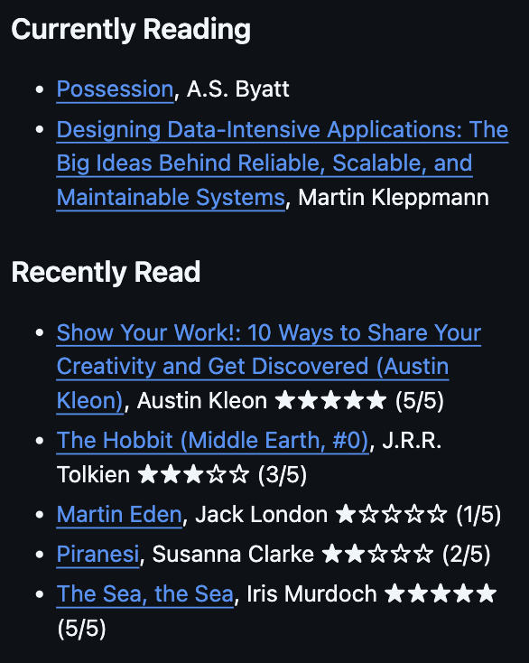

# Goodreads README Action

> [!WARNING]
> Goodreads [discontinued RSS in October 2026](https://www.goodreads.com/blog/show/20-more-rss-feeds), which was required for this action to successfully run. Releases v1.0.0 and v1.0.1 are affected by a 404 returned from the RSS path, but existing README content is preserved. Use v2.0.0 for the new widget-based shelf fetching method!

Automatically update your profile README with any of your public [Goodreads](https://goodreads.com) shelves!

## Why

This action is for developers who read a lot (like myself). It uses Goodreads' widget feature to pull shelf data and replaces _part_ of your profile README automatically.
See my [GitHub profile](https://github.com/quentinlintz) for an example of the output.



## Setup

### Full example

`README.md`

```markdown
### Currently Reading

<!-- GOODREADS-CURRENTLY-READING:START -->
<!-- GOODREADS-CURRENTLY-READING:END -->

### Recently Read

<!-- GOODREADS-READ:START -->
<!-- GOODREADS-READ:END -->
```

`.github/workflows/goodreads-workflow.yml`

```yml
name: Sync Goodreads

on:
  schedule:
    - cron: "0 0 * * 0" # Weekly, Sundays at 00:00 UTC
  workflow_dispatch:

permissions:
  contents: write

concurrency:
  group: ${{ github.workflow }}-${{ github.ref }}
  cancel-in-progress: false

jobs:
  update-reading:
    name: Update README with Goodreads shelves
    runs-on: ubuntu-latest
    steps:
      - name: Checkout
        uses: actions/checkout@v4

      - name: Pull currently reading
        uses: quentinlintz/goodreads-readme-action@v2.0.0
        with:
          goodreads-user-id: 160841838 # Replace this with your Goodreads profile ID
          shelf: currently-reading
          section: GOODREADS-CURRENTLY-READING
          sort: date-added
          show-rating: false
          max-books: 5

      - name: Pull recently read
        uses: quentinlintz/goodreads-readme-action@v2.0.0
        with:
          goodreads-user-id: 160841838 # Replace this with your Goodreads profile ID
          shelf: read
          section: GOODREADS-READ
          sort: date-read
          show-rating: true
          max-books: 5

      - name: Commit Goodreads shelves
        run: |
          if [ -n "$(git status --porcelain README.md)" ]; then
            git config user.name "goodreads-books-bot"
            git config user.email "goodreads-books-bot@example.com"
            git add README.md
            git commit -m "Render Goodreads shelves"
            git push
          fi
```

### Steps

- Go to your Goodreads profile. The numeric part of the URL is your Goodreads profile ID. Example: `https://www.goodreads.com/user/show/160841838-quentin-lintz`, mine is "160841838".

- Add matching HTML-comment markers to your GitHub profile's README.md for replacing.

- Add `quentinlintz/goodreads-readme-action@v2.0.0` to a workflow in your GitHub profile repo. Save it under `.github/workflows/`.

- When you've pushed this, trigger the workflow from the Actions tab and your README will be updated.

## Inputs

| Name              | Description                              | Accepts                 | Default           |
| ----------------- | ---------------------------------------- | ----------------------- | ----------------- |
| goodreads-user-id | your profile ID                          | number                  | required          |
| readme-path       | a file path, including subdirectories    | string                  | README.md         |
| shelf             | your Goodreads shelf to target           | string                  | currently-reading |
| section           | the name shared by the START/END markers | string                  | GOODREADS-LIST    |
| sort              | newest first: supplied by Goodreads      | date-added or date-read | date-added        |
| show-rating       | stars that represent your book ratings   | boolean                 | false             |
| max-books         | limit to the number of books rendered    | positive integer        | 10                |

## Behavior

Here's a selection of widget_code examples and their rendered output for a visual of how this action should behave. I'm using part of my [Currently Reading](https://www.goodreads.com/review/list/160841838-quentin-lintz?ref=nav_mybooks&shelf=currently-reading) shelf's widget response as an example here. These are by default sorted by most recently added first (on top).

### Multiple books

[Shelf widget_code HTML](/tests/fixtures/widget-currently-reading.expected.html)

Profile README:

```markdown
<!-- GOODREADS-LIST:START -->

- [Designing Data\-Intensive Applications: The Big Ideas Behind Reliable, Scalable, and Maintainable Systems](https://www.goodreads.com/review/show/8889919757), Martin Kleppmann
- [The Black Prince](https://www.goodreads.com/review/show/9046024131), Iris Murdoch

<!-- GOODREADS-LIST:END -->
```

The stars are omitted if the book does not have a user rating or if the user hasn't enabled it. Goodreads supplies the ordering.

### Empty shelf

[Shelf widget_code HTML](./tests/fixtures/widget-valid-empty.expected.html)

Profile README:

```markdown
<!-- GOODREADS-LIST:START -->

Shelf is empty
<!-- GOODREADS-LIST:END -->
```

### Bad input

If we make a request with an invalid...

- **malformed goodreads id**: fail validation
- **shelf name**: Goodreads substitutes the shelf with your "read" shelf, but we don't detect this and _may pass_ the read shelf through.

Validation and request failure report an error and preserve your README section.

## Credits

Written by Quentin Lintz, by hand. AI produced no parts of this code.

Inspired by [zwacky/goodreads-profile-workflow](https://github.com/zwacky/goodreads-profile-workflow).
